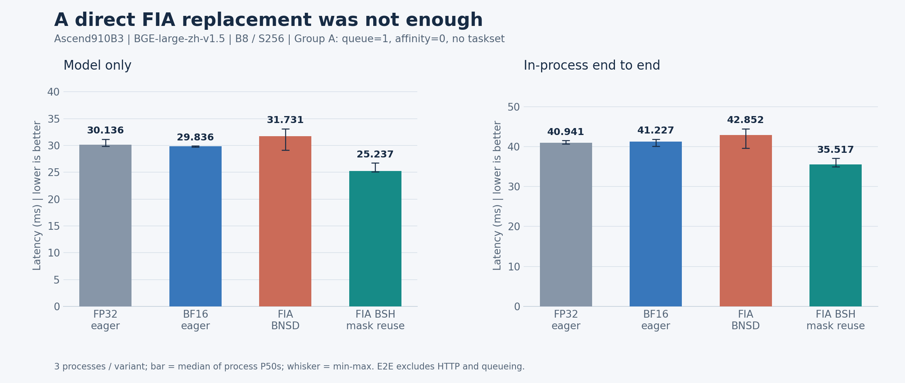

# BGE 在昇腾 910B3 上的 PyTorch 在线推理迁移与调优

代码仓库：[GitHub](https://github.com/huanghonggit/ascend-bge-online-inference-lab) · [GitCode](https://gitcode.com/qq_36533552/ascend-bge-online-inference-lab)

把 BAAI/bge-large-zh-v1.5 迁到 NPU 后，单改 BF16 几乎没有降低模型时延，直接替换 FIA 甚至更慢。本案例记录了随后如何用 Profiler、BSH 布局、mask 复用、任务队列、CPU 绑核和 TorchAir 找到可复验的收益。

这是依据模型作者用法和昇腾 API 编写的教学工程，**不是昇腾官方 BGE 性能基准**。课程使用常驻 PyTorch 模型在线编码，不导出 OM；每人可分配两张 910B3，实验只占用其中一张，不设性能排行榜。

- [完整实操教程](docs/tutorial.md)：拉取指定容器、CPU 参考、NPU 迁移、HTTP 服务、调优、质量验收。
- [实测结果与原因分析](docs/results.md)：为什么原 FIA 和 BF16 eager 没有明显加速。
- [测量方法与数据说明](docs/methodology.md)：时延口径、原始样本、复算方式和脱敏范围。
- [官方来源](docs/sources.md)：昇腾官网、GitCode Ascend/CANN、模型作者资料。
- [发布验证记录](docs/validation.md)：本地检查与原服务器实测的边界。

## 实测要点

2026-11-15，单张 Ascend910B3，B8/S256，固定模型提交与输入。表中模型时延为三个独立进程各自 P50 的中位数；E2E 是进程内分词、H2D、模型、D2H，**不包含 HTTP 网络、并发及排队**。

| 对照 | 模型 P50：前 → 后 | 相对变化 | 说明 |
|---|---:|---:|---|
| A：BF16 eager → 原 FIA BNSD | 29.836 → 31.731 ms | 慢 6.4% | 直接替换没有收益 |
| A：BF16 eager → FIA BSH + mask 复用 | 29.836 → 25.237 ms | 降低 15.4% | 三轮均改善，整条路径收益 |
| D → T：改进 FIA 加 CPU 绑核 | 20.017 → 18.417 ms | 降低 8.0% | 两组均使用 queue=2 |
| A BF16 → T 改进 FIA | 29.836 → 18.417 ms | 降低 38.3% | 组合结果，分阶段测量 |
| A：TorchAir FP32 → TorchAir BF16 | 30.754 → 12.931 ms | 降低 58.0% / 2.38× | 同图模式三轮交错，不含首次编译 |

BF16 eager 的设备 Computing 从 28.184 降至 13.680 ms，但同步墙钟几乎不变。Profiler 中 kernel 数和 kernel 区间 gap 增大，结合 queue=2、绑核、图模式的对照，支持“主机下发等开销掩盖设备计算收益”的判断。**这些证据不能精确拆出每毫秒的因果，也不能将 Profiler 与非 Profiler 墙钟相减。**

## 目录

~~~text
bge_lab/                 模型加载、原 FIA 适配、质量和测量代码
configs/                 固定实验条件与质量门槛
scripts/                 两卡容器、配套环境安装和激活
experiments/             FIA BSH 补丁、阶段编排、微基准和汇总
serve.py                 单进程串行 HTTP 在线推理示例
results/2026-11-15/       43 个计时进程、4 个 Profiler 进程的脱敏结果
figures/                 数据驱动生成的 PNG / SVG
tools/                  数据审计、绘图脚本（运行时无需 NPU）
~~~

## 先阅读，再运行

[教程](docs/tutorial.md)从 Windows PowerShell 上传开始，远端 Linux 命令有明确标记。不要直接执行 experiments 中的模板；先用 init_replay.py 生成独立实验目录，并显式提供当前服务器的 CPU 核范围。

~~~bash
# Linux 容器；完整环境准备见教程
python experiments/init_replay.py --lab "$PWD" --root /workspace/bge-replay-01 --cpus "$NPU_CPUS"
python /workspace/bge-replay-01/replay_stage.py baseline
~~~

只在本地查看结果与重绘图：

~~~powershell
python tools/verify_results.py
python -m pip install -r requirements-figures.txt
python tools/plot_results.py
~~~

原始实验已在服务器执行；公开版增加了路径参数化、脱敏导出、审计与文档。这些发布改动没有重新在 NPU 上执行。FIA 的共享 mask 补丁仅验证串行 eager；未验证它与 TorchAir 的组合或同模型实例并发。

原创代码、教程和合成教学数据使用 [MIT 许可证](LICENSE)。模型权重不随仓库分发，第三方依赖和模型许可见 [THIRD_PARTY_NOTICES.md](THIRD_PARTY_NOTICES.md)。
