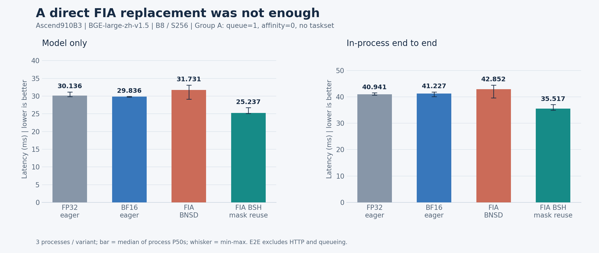
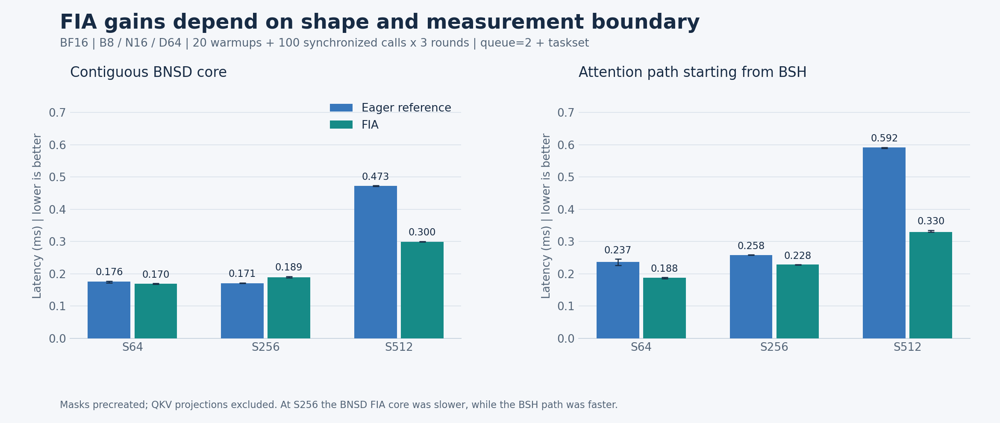
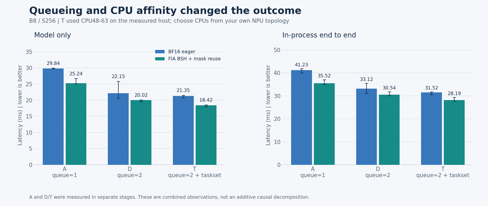
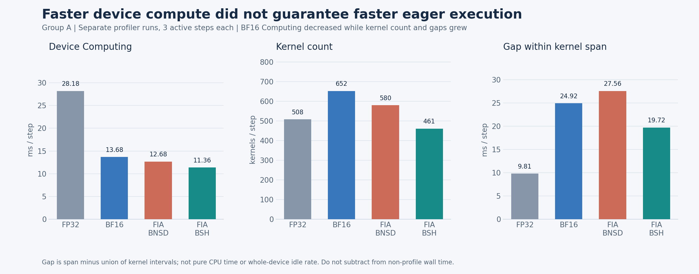
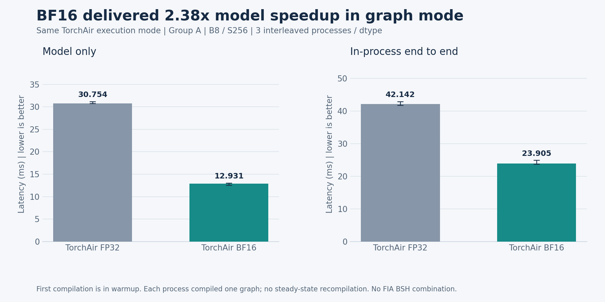

# 实测结果：FIA 与 BF16 为什么起初没有加速

在固定 B8/S256 条件下，BF16 eager 的模型 P50 为 29.836 ms，FP32 为 30.136 ms；原 FIA 为 31.731 ms。这个结果不能证明 BF16 或 FIA 无效。后续同模式对照显示：改进 FIA 的调用路径能缩短模型时延，而 BF16 在 TorchAir 图模式中获得了明显收益。

下面所有模型数据来自单张 Ascend910B3，完整软件、输入和统计口径见 [测量方法](methodology.md)。数据文件为 [group_summary.json](../results/2026-11-15/group_summary.json)，各表保留到 3 位小数；图的误差条是各进程 P50 的最小到最大范围，不是置信区间。

## 1. 同一 A 环境下，原 FIA 失败在哪里

A：CPU_AFFINITY_CONF=0、TASK_QUEUE_ENABLE=1，无外部绑核。每种实现三轮交错执行。

| 实现 | 模型 P50 ms | 进程内 E2E P50 ms |
|---|---:|---:|
| FP32 eager | 30.136 | 40.941 |
| BF16 eager | 29.836 | 41.227 |
| 原 FIA BNSD | 31.731 | 42.852 |
| FIA BSH + mask 复用 | 25.237 | 35.517 |

原 FIA 对每层输入进行布局转换、contiguous、mask 物化及输出转换。改为直接 BSH 输入并在一次 encoder forward 内复用 mask 后，相对 BF16 eager 的模型时延下降 15.4%，三轮均改善。只复用 mask、继续使用 BNSD 的确认组为 29.854 ms，说明不能把全部收益归给 mask 缓存。

Profiler 的 host contiguous 次数从原 FIA 的 96/step 降到 0，copy_ 从 99 降到 3，mask lt 从 24 降到 1。BF16 eager 和原 FIA 的设备 Transpose 都是 96/step，改进 FIA 为 0；因此不能声称“原 FIA 比 eager 多出了 96 个设备 Transpose”。

更关键的反例是：Profiler 中原 FIA kernel 合计约 1.676 ms，BSH FIA 约 2.132 ms。**改进路径的总体收益并不是因为 BSH 内核本身更快。**少做布局转换和重复 mask、减少主机调用与下发压力，才符合本次多项观测。

## 2. FIA 单算子能加速，但依赖形状和对照边界

正式微基准固定 B8/N16/D64、BF16、queue=2、taskset；mask 预先创建，不含 QKV 投影。参考实现对齐安装版 BERT 的 BF16 softmax。每实现 20 次预热、100 次同步采样、3 轮。

| S | eager 核心 BNSD ms | FIA 核心 BNSD ms | eager 从 BSH 开始 ms | FIA BSH ms |
|---:|---:|---:|---:|---:|
| 64 | 0.175570 | 0.170070 | 0.237470 | 0.187545 |
| 256 | 0.171380 | 0.188700 | 0.258235 | 0.228385 |
| 512 | 0.472515 | 0.299650 | 0.592170 | 0.329725 |

S256 的连续 BNSD 核心对照中，FIA 反而慢约 10.1%；从 BSH 输入比较，FIA 路径快约 11.6%。S512 两种边界均有收益：核心时延下降约 36.6%，从 BSH 开始的路径下降约 44.3%。因此“调用 FIA 必然更快”不成立，“FIA 完全不能加速”也不符合实测。

单独 FP64 归约的精度检查最小 cosine 为 0.999995644，最大绝对误差为 0.0009765625。微基准原记录中 FP32 归约可能让 cosine 略大于 1，公开数据保留原数值，但精度结论使用 [micro_accuracy_fp64.json](../results/2026-11-15/micro_accuracy_fp64.json)。

## 3. queue=2 和 CPU 绑核

| 环境 / 实现 | 模型 P50 ms | 进程内 E2E P50 ms |
|---|---:|---:|
| A：BF16 | 29.836 | 41.227 |
| D：queue=2，BF16 | 22.149 | 33.125 |
| T：queue=2 + taskset，BF16 | 21.352 | 31.522 |
| A：改进 FIA | 25.237 | 35.517 |
| D：queue=2，改进 FIA | 20.017 | 30.544 |
| T：queue=2 + taskset，改进 FIA | 18.417 | 28.189 |

D 与 T 均关闭自动绑核。原机器的 NPU6/7 邻近 CPU48–71，T 手工限制到 48–63；这组核号不可直接移植到其他机器。改进 FIA 从 D 到 T 下降 8.0%，三轮均改善。BF16 从 D 到 T 仅中位数改善，并非每轮都快。

A BF16 到 T 改进 FIA 的模型时延下降 38.3%，E2E 从 41.227 降到 28.189 ms。这是队列、布局/mask 与 CPU 亲和共同作用下的结果，A 和 D/T 分阶段测量，不能画成严格同期随机实验的逐项因果贡献图。自动绑核筛查只跑一轮，单列为 screen；它不足以替代三轮确认。

原环境中自动绑核后的热点落在 CPU1/2，外部 taskset 将观察到的 51 个线程限制在 48–63。这里记录运行时现象，没有足够证据将其定性为底层实现缺陷。taskset 也不等于 NUMA 内存绑定。

## 4. BF16 的计算变快，为何 eager 墙钟没变

BF16 是低精度浮点格式，本实验做的是参数与运算 dtype 转换，没有执行 INT8 量化、校准或量化感知训练。

| Profiler 指标（每组 3 个 active steps） | FP32 | BF16 | 原 FIA | 改进 FIA |
|---|---:|---:|---:|---:|
| kernels / step | 508 | 652 | 580 | 461 |
| Computing ms | 28.184 | 13.680 | 12.677 | 11.357 |
| kernel 区间 gap ms | 9.808 | 24.916 | 27.561 | 19.716 |

BF16 的 Computing 比 FP32 少 51.5%，Addmm 计算合计由 19.285 降至 5.759 ms，说明设备上的矩阵计算确实得到加速。BF16 多出的 144 个 Addmm Cast 合计只有约 0.171 ms，解释不了十多毫秒收益为何没有反映到墙钟上。

与此同时，kernel 数从 508 增到 652，kernel 区间 gap 变大；queue=2、绑核和图执行又改善了模型墙钟。把这些证据一起看，主机下发、框架处理和调度间隙掩盖设备收益，是较有支持的解释。这里没有足够证据把每一毫秒分别归因给 Python、CPU 调度或驱动。

gap 的定义是单步首个 kernel 开始到最后一个 kernel 结束的跨度，减去 kernel 执行区间的并集。它不是纯 CPU 时间，不是整卡空闲率，也不包含该跨度以外的处理。Profiler 与非 Profiler 分开运行，不能相减拼成端到端分解图。

矩阵精度记录中 matmul_allow_hf32=false、float32_matmul_precision=highest、autocast_npu=false。conv_allow_hf32=true 是记录到的设置，但本模型的主要对照是 Transformer 线性层，不能据此把 FP32 基线改称 BF16 或 HF32 基线。

## 5. 同图模式下，BF16 收益显现

A 环境中，TorchAir FP32/BF16 三轮交错，形状与输入保持一致：

| TorchAir 实现 | 模型 P50 ms | 进程内 E2E P50 ms |
|---|---:|---:|
| FP32 | 30.754 | 42.142 |
| BF16 | 12.931 | 23.905 |

BF16 模型时延降低约 58.0%，加速比 2.38×。六个进程各编译一张图，稳态未发生重编译，首次编译计入预热而不计入稳态样本。这说明 BF16 在本模型上并非“量化无效”，但该结果也包含编译器按 dtype 产生的优化差异，不是单个矩阵 kernel 峰值比较。

本仓库没有把改进 FIA 和 TorchAir 拼成未经验证的最优配置；二者叠加需要另做算子支持、编译稳定性和精度验证。

## 6. 质量验收与适用边界

BF16、改进 FIA、TorchAir FP32、TorchAir BF16 均通过冻结 CPU FP32 参考的完整质量门槛。教学集含 32 corpus、64 queries 和 8 smoke，各候选 Recall@1=0.890625、Recall@5=1.0、MRR@10=0.9453125；Recall@5 与 MRR@10 相对参考无下降。详见 [quality.json](../results/2026-11-15/quality.json)。

结论适用于本次固定版本、模型、输入与串行执行。它不能外推为生产检索精度、大规模并发吞吐、HTTP 尾延迟或所有序列长度的加速承诺。课程推荐把“质量先通过、边界先对齐、数据能复算”作为验收标准，允许并保留没有性能收益的结果。
