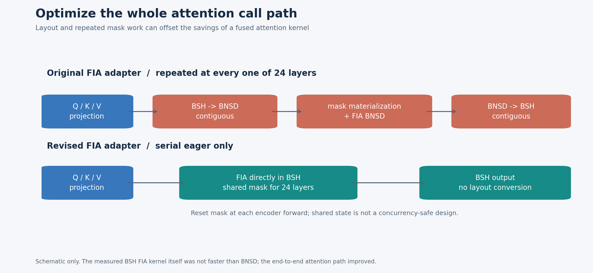

# 从 CPU 参考到 910B3 在线推理：完整实操

本课使用 BAAI/bge-large-zh-v1.5 生成中文检索向量。先建立 CPU FP32 参考，再在一张 910B3 上完成 PyTorch 迁移、质量验证和性能分析。容器只映射分配给学员的两张计算卡，实验进程使用逻辑 npu:0。

建议安排半天至一天，模型下载和首次编译时间另计。下面的教学时间是课程安排建议，不是实测耗时承诺。

| 环节 | 建议用时 | 学员交付 |
|---|---:|---|
| 环境与 CPU/NPU 迁移 | 60–90 分钟 | 环境探针、CPU 参考、迁移质量报告 |
| 常驻在线服务 | 20–30 分钟 | health 和 embedding 请求结果 |
| FIA 与 Profiler | 60–90 分钟 | 原 FIA、BSH 改进、kernel 证据 |
| 队列、绑核、TorchAir | 60–90 分钟 | 同条件三轮结果与限制说明 |
| 报告 | 30 分钟 | 对照表、质量门槛、失败或无收益解释 |

## 1. 实测环境与前提

| 项目 | 本案例的固定值 |
|---|---|
| 加速卡 | Ascend910B3，实际执行一张 |
| 镜像 | swr.cn-south-1.myhuaweicloud.com/ascendhub/cann:9.1.0-910b-ubuntu22.04-py3.12 |
| 软件 | CANN 9.1.0；Python 3.12.13；torch 2.9.0；torch_npu 2.9.0.post6；Transformers 5.3.0 |
| 模型快照 | 79e7739b6ab944e86d6171e44d24c997fc1e0116 |
| 模型结构 | 24 层、hidden=1024、16 heads、head_dim=64 |
| 性能对照 | B8、S256、右侧固定 padding、CLS 后 FP32 L2 归一化 |
| 主机 | Kunpeng 920；192 逻辑 CPU；8 NUMA 节点；容器 16 CPU 配额 |
| 线程 | torch CPU threads=4；OMP/MKL=8 |

完整冻结依赖见 [requirements-server.freeze.txt](../requirements-server.freeze.txt)。这是本案例跑通的环境，不代表任意驱动、任意版本组合都兼容。镜像 tag 不是不可变 digest；复现实验时记录 docker inspect 的镜像 ID、RepoDigests，以及宿主机驱动/固件版本。

本案例的旧记录中 TorchAir 包元数据可能为 null，因为它随 torch_npu 提供；请以能否 import、模块路径和编译探针判断，不能据此断言未安装。

## 2. 获取代码、连接服务器

本机 Windows PowerShell。将 SERVER_USER、SERVER_HOST 替换为自己的账号和地址；不要在命令文件或仓库保存密码。

~~~powershell
git clone https://github.com/huanghonggit/ascend-bge-online-inference-lab.git
# 也可从 GitCode 克隆：
# git clone https://gitcode.com/qq_36533552/ascend-bge-online-inference-lab.git
Set-Location ascend-bge-online-inference-lab
$server = 'SERVER_USER@SERVER_HOST'
ssh $server 'mkdir -p ~/bge-online-workspace'
scp -r . "$($server):~/bge-online-workspace/ascend-bge-online-inference-lab"
ssh $server
~~~

已有 Git 的 Linux 服务器可直接克隆到 ~/bge-online-workspace/ascend-bge-online-inference-lab。不要覆盖同名已有实验目录。所有后续 shell 命令，除明确写 PowerShell 的段落外，都在 Linux 执行。

## 3. 仅映射两卡创建容器

Linux 宿主机。先检查分配卡号和当前占用，再设置两个不同的物理卡号。以下 6、7 是原实验示例，必须换成分配给自己的卡。

~~~bash
npu-smi info
export NPU_FIRST=6
export NPU_SECOND=7
export HOST_WORKSPACE="$HOME/bge-online-workspace"
export CONTAINER_NAME=bge-online-lab
cd "$HOST_WORKSPACE/ascend-bge-online-inference-lab"
bash scripts/create_container.sh

docker inspect --format '{{json .HostConfig.Devices}}' "$CONTAINER_NAME"
docker image inspect swr.cn-south-1.myhuaweicloud.com/ascendhub/cann:9.1.0-910b-ubuntu22.04-py3.12 --format '{{.Id}} {{json .RepoDigests}}'
docker exec -it "$CONTAINER_NAME" bash
~~~

脚本参考昇腾官方容器设备挂载方式：只映射指定的两个 /dev/davinciN，加上 davinci_manager、devmm_svm、hisi_hdc 管理设备；驱动相关目录只读挂载。它不会创建特权容器，不修改宿主机驱动，遇到同名容器会停止。脚本使用 --cpus=16 与 --shm-size=8g。

npu-smi 可能通过管理设备显示更多硬件信息，因此不能只凭它的列表判断计算卡隔离。进入容器后确认 /dev/davinci* 和 torch.npu.device_count()；计算设备应为两张。本实验不启动分布式任务。

## 4. 安装冻结环境并做探针

Linux 容器：

~~~bash
cd /workspace/ascend-bge-online-inference-lab
bash scripts/install_env.sh
source scripts/activate_lab.sh
python -m pip check
python -c 'import torch,torch_npu; print(torch.__version__,torch_npu.__version__); print(torch.npu.device_count())'
python lab.py doctor --device npu:0 --with-optimizers --out runs/environment.json
~~~

安装脚本创建隔离 venv /opt/bge-venv，使用冻结依赖，不继承系统 site-packages。每个新 shell 都重新 source scripts/activate_lab.sh。不要用来源不明的同名 torchair 包替换配套组件。

环境探针检查 BF16 matmul、FIA、TorchAir 编译和有限值。失败时先核对驱动、CANN、PyTorch、torch_npu、Python 配套，再检查是否激活正确 venv。成功后才进入完整模型实验。

## 5. 下载模型并冻结输入

~~~bash
python prepare_model.py --download --model models/bge-large-zh-v1.5
python prepare_model.py --verify --model models/bge-large-zh-v1.5
~~~

下载程序固定 40 位模型提交，并生成 model_manifest.json；验证会检查模型文件列表、字节数和 SHA256。受限网络可在能访问模型站点的机器下载同一提交，然后上传整个模型目录并执行 --verify。不要换用 main 分支或其他 BGE 变体后继续引用本案例的性能。

data 已包含 32 篇合成文档、64 条查询、8 条 smoke 文本、1024 条性能请求和相关性标签，内容为虚构教学政策，不是正式质量榜单。性能补充实验只取前 128 条请求，按 8 条组成 16 个批次。不要为得到更好结果修改输入或门槛。

query 添加模型作者推荐的中文查询前缀，passage 不添加。所有对照都使用同一 tokenizer、截断规则、右侧 padding、CLS pooling 和 FP32 L2 归一化。token ids、attention mask 保持整型，不能把整个输入字典直接转 BF16。

## 6. CPU 参考与 NPU 迁移

先生成一次质量参考，后续候选都对它比较：

~~~bash
python lab.py quality --config configs/cpu_reference.json --out runs/ref_cpu_fp32
python lab.py infer --config configs/npu_fp32.json --texts '如何申请课程实验账号？' '模型迁移如何检查精度？' --out runs/first_npu.json
python lab.py quality --config configs/npu_fp32.json --reference runs/ref_cpu_fp32 --out runs/npu_fp32
python lab.py quality --config configs/bf16.json --reference runs/ref_cpu_fp32 --out runs/bf16
~~~

CPU 参考耗时取决于服务器和线程配置。程序加载本地模型、调用 eval()、在 inference_mode 下执行；所有对照一致删除未使用的 BertPooler。模型和输入显式放到 npu:0，替换后检查输出形状、有限值、单位范数、向量误差和检索指标。

门槛保存在 configs/quality_gate.json：mean cosine≥0.995、最差样本 cosine≥0.98、max abs≤0.05、范数误差≤0.0002、Recall@5 下降≤0.015625、MRR@10 下降≤0.02。它们是预先冻结的教学阈值，不是官方 BGE 标准。quality.json 的 status 必须为 passed；失败不应通过临时放宽阈值解决。

## 7. 常驻 PyTorch 在线服务

一个容器 shell 启动服务：

~~~bash
python serve.py --config configs/online_b1.json --host 127.0.0.1 --port 8000
~~~

另一个容器 shell：

~~~bash
curl --fail http://127.0.0.1:8000/health
curl --fail http://127.0.0.1:8000/embed -H 'Content-Type: application/json' \
  --data '{"texts":["如何申请课程实验账号？"],"kind":"query"}'
~~~

若从 Windows 请求，先在本机另开终端建立隧道：

~~~powershell
ssh -N -L 8000:127.0.0.1:8000 SERVER_USER@SERVER_HOST
~~~

再在本机另一个 PowerShell 窗口执行：

~~~powershell
Invoke-RestMethod http://127.0.0.1:8000/health
$payload = @{texts=@('如何申请课程实验账号？'); kind='query'} | ConvertTo-Json
Invoke-RestMethod http://127.0.0.1:8000/embed -Method Post -ContentType 'application/json; charset=utf-8' -Body ([Text.Encoding]::UTF8.GetBytes($payload))
~~~

服务加载一次模型，串行处理请求，返回 1024 维向量。Ctrl+C 结束后再做性能测量，避免两个进程竞争同一卡。该服务用于在线推理功能演示，无身份认证和生产并发控制。B1 服务结果不能替代 B8 性能表；本文 E2E 时延也不是 HTTP 请求时延。

## 8. 确认 NPU 邻近 CPU 核

先在宿主机查看拓扑，再在容器确认可用 CPU：

~~~bash
# Linux 宿主机；以当前 npu-smi 的实际帮助为准
npu-smi info -t topo
lscpu -e=CPU,NODE,SOCKET,CORE
# Linux 容器
grep Cpus_allowed_list /proc/self/status
cat /sys/fs/cgroup/cpu.max 2>/dev/null || cat /sys/fs/cgroup/cpu/cpu.cfs_quota_us
~~~

原服务器的物理 NPU6/7 邻近 CPU48–71，实验选了 48–63。这个范围只属于原服务器。换机器、卡号或 cpuset 后必须重新选择；容器 CPU 配额和允许使用的 CPU 列表不是一回事。

~~~bash
# Linux 容器：填写经核验且属于容器允许范围的 CPU 集合
export NPU_CPUS=48-63
export REPLAY=/workspace/bge-replay-01
python experiments/init_replay.py --lab "$PWD" --root "$REPLAY" --cpus "$NPU_CPUS"
~~~

初始化器要求目标不存在，检查 Python/JSON 语法，然后将实验路径和核范围写入新目录。它本身不运行 NPU。不要直接运行仓库里的 experiment.py、runner.py 等模板，也不要把原示例核号当作通用设置。

## 9. 三轮基线：先复现“不加速”

~~~bash
python "$REPLAY/replay_stage.py" baseline
~~~

A 环境为 CPU_AFFINITY_CONF=0、TASK_QUEUE_ENABLE=1，无外部 taskset。四种实现按预置顺序交错运行三轮，每个实现单独启动进程：

| variant | 运算路径 |
|---|---|
| fp32 | 原始 FP32 eager |
| bf16 | 原始 BF16 eager |
| fia | BF16，逐层 BNSD FIA 适配 |
| fia_bsh | BF16，直接 BSH FIA，一次 forward 内复用 mask |

每进程预热 12 次，采样 64 次模型时延与 32 次进程内 E2E。模型计时输入已驻 NPU，前后 synchronize；E2E 包含分词、H2D、模型和 D2H。首次编译、模型加载与输出文件写入不计入稳态样本。

程序另保存 enqueue_wall，它可能包含 Python/框架执行及队列背压，不能称作纯 kernel 提交时间。基线第一组生成的 128 条 embedding 对照只是性能输入一致性检查，不能代替第 6 步的完整 CPU 参考验收。

## 10. FIA：减少转换与重复 mask

原始适配每层都将 Q/K/V 从 BSH 转为 BNSD 并 contiguous，将加法 mask 转 bool 并物化，再把输出转回 BSH。融合注意力省掉的设备计算，可能被调用路径上的开销抵消。

改进补丁位于 experiments/experiment.py 的 OptimizedFIA 和 patch：保留原 Q/K/V 投影权重，直接传 BSH；encoder 每次 forward 开始清空缓存，第一层生成 bool mask，后续层复用。attention scale=1/sqrt(64)，sparse_mode=0，pre_tokens/next_tokens 足够大，保持 BERT 双向注意力。bool True 表示屏蔽，不能误用 causal mask。

该补丁仅用于串行 eager 实验。共享 Python 字典不是可重入并发方案；同一个模型实例并发请求应改为请求局部状态，并重新验收。仓库没有提供 graph_fia_bsh 选项，因其与 TorchAir 的组合未验证。

## 11. queue=2、绑核和图模式

~~~bash
# 可选：单轮筛查，不能将它与三轮确认混合统计
python "$REPLAY/replay_stage.py" screen
# 正式确认：D/T、仅 mask 复用、图模式 FP32/BF16
python "$REPLAY/replay_stage.py" confirm
~~~

| 分组 | 自动绑核 | TASK_QUEUE_ENABLE | 外部 taskset |
|---|---|---:|---|
| A | 0 | 1 | 无 |
| D | 0 | 2 | 无 |
| T | 0 | 2 | --cpus 指定集合 |

筛查 B/C/F 还覆盖两种自动亲和模式，具体环境以 runner.py 为准。环境变量在子进程 import torch_npu 前设置；脚本清除 ASCEND_LAUNCH_BLOCKING。手工测量也应另启进程，不能在模型运行后才修改这些变量。

TorchAir 对照通过 torch.compile、fullgraph=True、dynamic=False 和计数 backend 执行。稳定图 FP32 与 BF16 是同一执行模式下的公平对照；预热吸收首次编译。检查 graph_count 和 graph_count_delta，本次各编一张图，稳态增量为零。不要把首次编译时间隐藏成服务启动无成本。

绑核是否有效要看当前拓扑和运行时线程亲和。原实验 T 对 FIA 三轮均改善；BF16 仅中位数改善，存在单轮反例。taskset 只限制 CPU，未做 NUMA 内存绑定，不得将结果解释成已完成内存亲和优化。

## 12. Profiler、微基准与完整质量

~~~bash
python "$REPLAY/replay_stage.py" profile
python "$REPLAY/summarize_profiles.py" --runs "$REPLAY/runs" --out "$REPLAY/profile_summary.json"
python "$REPLAY/replay_stage.py" micro
python "$REPLAY/replay_stage.py" micro_accuracy
python "$REPLAY/replay_stage.py" quality_eager
python "$REPLAY/replay_stage.py" quality_graph
python "$REPLAY/summarize_results.py" --root "$REPLAY" > "$REPLAY/group_summary.csv"
~~~

Profiler 使用 wait=1、warmup=1、active=3，单独运行。查看 kernel_details.csv、step_trace_time.csv 和 trace_view.json，重点核对 Addmm、Cast、Transpose、FIA，以及 host contiguous/copy_/lt 调用数。Profiler 有采集开销，不能与非 Profiler 墙钟相减画分解图。

微基准固定 B8/N16/D64、BF16，S=64/256/512，比较已连续 BNSD 的核心和从 BSH 输入开始的完整注意力路径。每组 20 次预热、100 次同步采样、3 轮，mask 预创建，不包含 QKV 投影。参考实现对齐当前安装版 BERT 的 softmax dtype。精度检查使用 FP64 归约的 micro_accuracy_fp64.json，避免 FP32 归约余弦略大于 1 的数值误导。

阶段失败后保留日志和 .started 标记，避免悄悄覆盖。修复原因后创建新的 REPLAY 目录重做所需链路；不要把部分失败结果混入正式汇总。quality 阶段还要求 CPU 参考存在，最终四个候选的 status 都应为 passed。

## 13. 读结果、提交报告

结果解释见 [results.md](results.md)。学员报告应说明：运行环境与模型/数据 hash；质量门槛及是否通过；每种实现三轮 P50 和范围；FIA 的布局/mask 变化；设备计算与整体时延是否一致；绑核是否每轮有效；图编译是否稳定。没有收益的实验也应保留。

本案例建议优先用同模式 FP32/BF16 对照确认低精度收益，再根据 Profiler 选择队列、绑核或布局优化。模型、shape、软件版本和并发条件改变后，需要重新测量。

完成后 Ctrl+C 停止自行启动的服务，检查 npu-smi 无本次遗留进程。保留结果目录；需要停止容器时只操作自己创建的 bge-online-lab，不删除共享模型或他人的容器。
